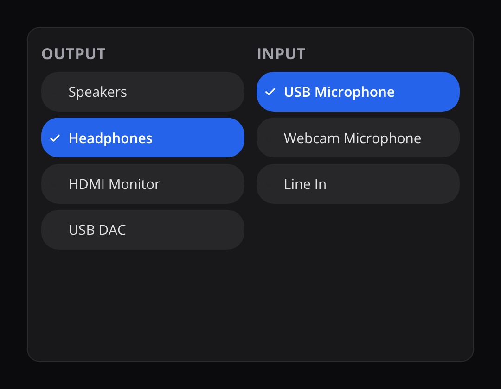
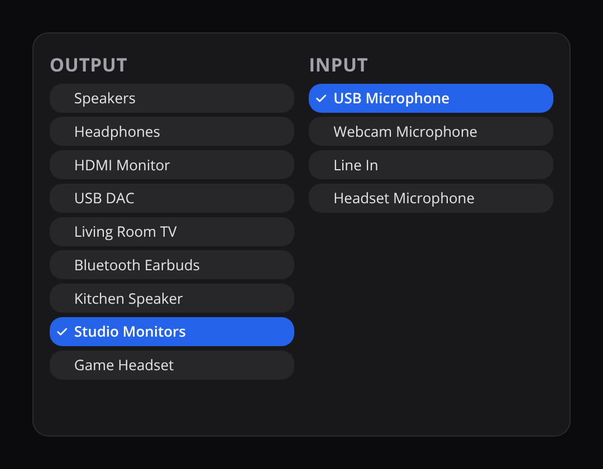
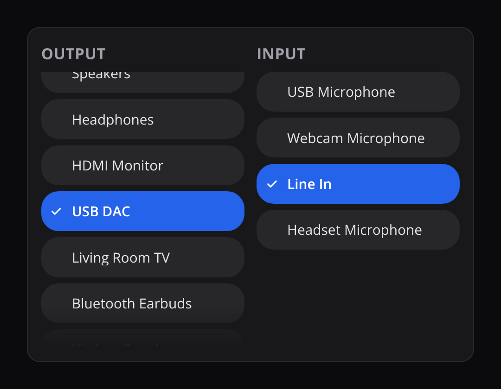

# Audio Device Switcher — Macro Deck 3 plugin

Two things for Macro Deck 3:

* **Audio devices widget**: a deck tile laid out for **4×3**. It has an **OUTPUT** column and an **INPUT** column that list every device your system reports and update live as devices come and go. The current default is highlighted in blue with a tick. Tap a device to make it the system default.
* **Set audio devices action**: sets the default output, input, or both, from any button, flow or automation. Both device pickers fill themselves from your system. Each one also has a "Don't change" option.

| Default (4x3) | Shrink to fit | Scroll |
|---|---|---|
|  |  |  |

The widget's settings cover overflow (shrink to fit or scroll), which columns to show (both, output only or input only), whether to move playing and recording apps, hidden devices, and Macro Deck's standard background, accent and border.

Backends:

| OS | How | Needs |
|---|---|---|
| Linux (PipeWire or PulseAudio) | `pactl` (`set-default-sink/source`; streams that are already playing or recording get moved too; live updates come from `pactl subscribe`) | `pactl` (Fedora/Debian: `pulseaudio-utils`, Arch: `libpulse`) |
| macOS | `SwitchAudioSource` | `brew install switchaudio-osx` |
| Windows 10/11 | Core Audio API: lists active endpoints and gets live change notifications. Sets the default for all three roles (console, multimedia, communications) through `IPolicyConfig`, the same interface the Sound control panel uses | nothing |

Monitor sources (`*.monitor`) are hidden from the input list. When you switch the mic, a recording that's capturing a monitor (for example OBS desktop audio) is never moved.

## Build and install

You need the .NET 10 SDK (with the ASP.NET Core runtime).

```bash
./build.sh            # builds, packs and validates into artifacts/
./build.sh --run      # runs it live against the open Macro Deck (approve the pairing prompt)
```

Then in Macro Deck go to **Integrations → Add → Install from file…**, pick `artifacts/com.benatkins.audio-switcher-*.macroDeckPlugin`, and confirm the unsigned-package prompt.

To add the tile, edit a profile, add a widget, and search for **Audio devices**. Then drag it to **4 columns × 3 rows**.

## Releasing

Every push builds and validates the plugin (`.github/workflows/build.yml`). To publish to the Macro Deck Store, create a GitHub release; `.github/workflows/release.yml` sends that build to the Creator Portal:

```bash
gh release create v1.1.0 --title "1.1.0" --notes "- What changed"
```

## Layout

```
src/AudioSwitcher/
  manifest.json                     plugin id, name, entrypoints (version is set from the release tag)
  macrodeck-build.json              per-platform publish settings
  Program.cs                        host builder
  PluginIntegration.cs              registers the action, the widget type, and serves the widget UI
  Widget/AudioDevicesWidget.cs      the 4x3 tile (declarative MacroDeck.Ui view + IUiSession)
  Widget/AudioDevicesConfigView.cs  the widget's settings screen
  Widget/WidgetOptions.cs           settings stored in the widget's data
  Actions/SetAudioDevicesAction.cs  "Set audio devices" action with dynamic device pickers
  Audio/AudioService.cs             shared snapshot, change feed, polling, switching
  Audio/PactlBackend.cs             Linux: pactl (JSON output, text fallback for pactl < 16)
  Audio/SwitchAudioSourceBackend.cs macOS
  Audio/WindowsCoreAudio*.cs        Windows: Core Audio + IPolicyConfig
  Localization/Strings.resx         UI strings (generated into the Strings class)
  Assets/icon.svg
screenshots/                        generic mockups for the README / Store
```

The plugin was written against the Macro Deck SDK 3.0.0 API.
